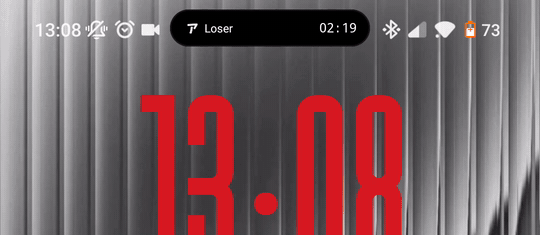
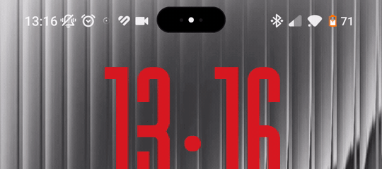
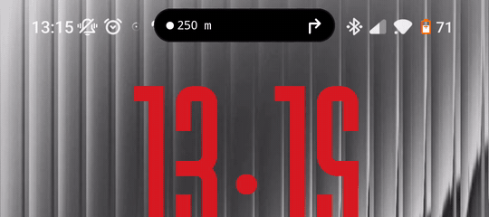
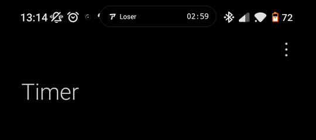

<div align="center">

# ● NOTHING ISLAND

**Eine Dynamic Island für Android im Nothing-OS-Look.**<br>
Schwarz, Monospace, roter Akzent, Punktmatrix-Ring.


<br>



</div>

<br>

## ✦ Auf einen Blick

| | |
|---|---|
| **Live-Pille** | Musik, Timer, Anruf, Navigation, Training und Downloads bleiben dauerhaft in der kleinen Pille. |
| **Meldungen** | Aufklappen, direkt antworten, als gelesen markieren, zusammenfassen, Codes kopieren. |
| **Schnellzugriff** | Kacheln auf mehreren Seiten, frei wählbar, mit Home-Assistant-Geräten. |
| **Animationen** | Federn, Pop-Effekte, rollende Ziffern, Squash beim Einklappen. |
| **Akku** | Sparmodus mit Stufen, Ausblenden bei Vollbild und Querformat. |

<br>

## ▶ Im Einsatz

<table>
  <tr>
    <td align="center"><b>Schnellzugriff</b><br><sub>mehrere Seiten, Smart Home</sub><br><br></td>
    <td align="center"><b>Navigation</b><br><sub>Live-Pille und aufgeklappt</sub><br><br></td>
  </tr>
  <tr>
    <td align="center" colspan="2"><b>Timer und Musik</b><br><sub>zwei Aktivitäten, Pille und Kreis tauschen</sub><br><br></td>
  </tr>
</table>

<br>

## ⬇ Installieren

1. Unter **Releases → latest** die `NothingIsland.apk` laden. Jede Version gibt es zusätzlich als `NothingIsland-v1.N.apk`.
2. Installieren. Eine vorhandene Version wird überschrieben, deine Einstellungen bleiben.
3. App öffnen und drei Berechtigungen vergeben:
   - **Über anderen Apps anzeigen**
   - **Zugriff auf Benachrichtigungen**
   - **Bedienungshilfe**, damit die Island auch über der Statusleiste liegt
4. Im START-Tab mit **TEST ANZEIGEN** ausprobieren.

> Die Versionsnummer steht im START-Tab und im Dateinamen. Du brauchst Android 10 oder neuer.

<br>

## ✦ Funktionen

<details open>
<summary><b>Kleine Pille und Live-Aktivitäten</b></summary>
<br>

- Ruhe-Pille um die Frontkamera, kompakte Pille für laufende Aktivitäten.
- Bei mehreren Aktivitäten zeigt ein Kreis daneben die zweite, Antippen tauscht sie.
- Statuspillen für Taschenlampe, Flugmodus, Hotspot, Ladegerät, Bluetooth-Kopfhörer, Akku-Warnung (20 % und 10 %), nächsten Termin und Zwischenablage.

</details>

<details open>
<summary><b>Meldungen</b></summary>
<br>

- Neue Benachrichtigungen klappen auf, mit App-Name, Titel und Text.
- **Antworten**, ohne die App zu öffnen.
- **Als gelesen markieren** per Haken oder indem du die Meldung nach unten ziehst (nur bei Meldungen, die das unterstützen).
- **Mehrere Meldungen** nacheinander mit Zähler „+N". Meldungen derselben App werden zusammengefasst.
- **Bestätigungscodes** werden erkannt, ein Tipp kopiert sie.
- Regeln pro App.

</details>

<details open>
<summary><b>Aufgeklappte Ansichten</b></summary>
<br>

| Ansicht | Inhalt |
|---|---|
| **Musik** | Cover, Titel, Spulleiste mit ziehbarem Strich, Play/Pause, Vor/Zurück, Spulen-Tasten für Podcasts. Wischen links und rechts auf der Pille wechselt den Song. |
| **Anruf** | Details, Stumm, Lautsprecher. |
| **Laden** | Erweiterte Ansicht mit Leistung, Temperatur und Restzeit. |
| **Training** | Zeit und Werte wie Puls, Distanz und Tempo. |
| **Navigation** | Nächste Abbiegung, Beenden-Taste. |

</details>

<details open>
<summary><b>Schnellzugriff und Smart Home</b></summary>
<br>

- Tippen auf die Ruhe-Pille öffnet ein Panel mit Kacheln, mehrere Seiten zum Wischen.
- Kacheln frei wählbar, auch beliebige Apps.
- **Home Assistant:** Geräte als Kacheln, Lampen mit Helligkeitsregler. Die Anmeldung läuft direkt über Home Assistant, der Server wird automatisch gefunden.

</details>

<details open>
<summary><b>Animationen</b></summary>
<br>

- Federn mit leichtem Nachschwingen, bei großer Pille ruhiger.
- Neue Inhalte poppen in der kleinen Pille auf, Symbole federn.
- Große Bubble schrumpft zur Pille erst kleiner, dann kurz breiter (Squash, abschaltbar).
- Rollende Ziffern bei Timern, animierte Ladeanzeige, pulsierendes Symbol bei klingelndem Anruf.
- Tasten drücken sich federnd ein, Kacheln werden beim Drücken weiß.

</details>

<details>
<summary><b>Anpassen</b></summary>
<br>

Fünf Tabs: **START**, **LAYOUT**, **FUNKTION**, **DESIGN**, **APPS**.

- Position, Größe, Breite, Rundung, Anzeigedauer, Haptik.
- Themen, Akzentfarbe und eigene Farben, gut lesbar auch bei hellen Farben.
- Für fast jede Funktion gibt es einen Schalter.

</details>

<details>
<summary><b>Akku</b></summary>
<br>

- Sparmodus mit Stufen im START-Tab.
- Im Hintergrund wird nichts abgefragt, wenn der Bildschirm aus ist.
- Optional ausblenden bei Vollbild (Video, Spiele) und im Querformat.

</details>

<br>

## ⚙ So funktioniert es

```
Benachrichtigung ─► IslandListenerService ─► IslandBus ─► IslandUi (Compose) ─► Overlay
```

- `IslandListenerService` ist ein `NotificationListenerService` und liest die Benachrichtigungen.
- Ein Bedienungshilfe-Dienst zeigt die Island als Overlay über der Statusleiste.
- Drei Fenster: ein sichtbares ohne Touch, ein kleines unsichtbares für Berührungen (leitet sie weiter) und eines für die Antwort-Eingabe. Auf dem Sperrbildschirm gibt es keinen Touch.
- Die Oberfläche ist komplett in Compose (`IslandUi.kt`), der Zustand läuft über `IslandBus`.
- Einstellungen liegen in SharedPreferences, der Home-Assistant-Zugang im privaten App-Speicher.

<br>

## 🛠 Selbst bauen

Der Workflow `.github/workflows/build.yml` baut bei jedem Push und veröffentlicht die APK unter **Releases → latest**. Die Versionsnummer ist `1.<Lauf-Nummer>`.

Lokal geht es mit Android Studio oder:

```bash
gradle assembleDebug
```

<br>

## ⚠ Bekannte Grenzen

- Manche Hersteller beenden Hintergrunddienste. Dann Akku-Optimierung für die App ausschalten und Autostart erlauben.
- Stumm und Lautsprecher bei Anrufen können von Android blockiert werden.
- Zwischenablage lesen und Vollbild-Erkennung hängen vom Gerät ab. Der START-Tab zeigt Diagnose-Karten.
- Die echte Nothing-Schrift ist lizenziert und nicht enthalten, als Ersatz dient eine Monospace-Schrift.
- Die Home-Assistant-Anmeldung läuft über eine lokale Rückleitung auf dem Handy und wurde nur auf einem Gerät getestet.
